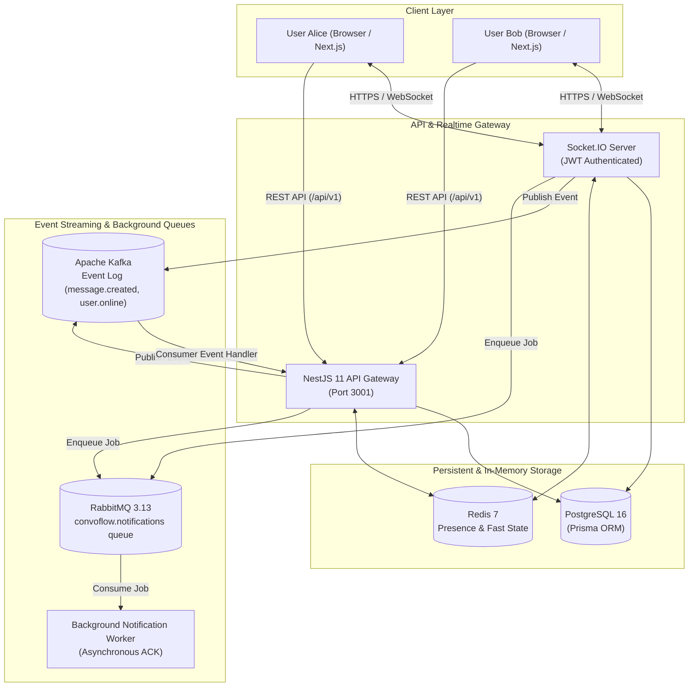

# ConvoFlow

> A production-grade, real-time communication platform engineered with Next.js 16, NestJS 11, Socket.IO, Redis, Apache Kafka, RabbitMQ, and PostgreSQL with Prisma.

---

## 📖 Overview

**ConvoFlow** is an end-to-end real-time chat application built for scalable messaging, live user presence, typing indicators, read receipts, and event-driven background processing. Designed as a unified full-stack monorepo, it demonstrates modern distributed systems concepts including WebSocket room multiplexing, Redis presence caching, Kafka event streaming, and RabbitMQ background job workers.

---

## 🏛 Architecture Diagram



---

## ⚡ Key Features

- **Authentication & Security**: Secure bcrypt password hashing, JWT access tokens with refresh token rotation, public route decorators, and NestJS guards.
- **Direct & Group Conversations**: 1-on-1 direct messaging (with duplicate conversation prevention) and multi-user group channels with Admin/Member roles.
- **Sub-Millisecond Real-Time Messaging**: Socket.IO room-based event broadcasting (`message:new`, `message:read`).
- **Live User Presence**: Track online/offline status in real-time backed by Redis sets with TTL heartbeats and fallback synchronization to PostgreSQL.
- **Typing Indicators**: Real-time debounce typing notifications (`typing:start`, `typing:stop`) with automatic inactivity timeouts.
- **Message Read Receipts**: Granular message status progression (`SENT` ➔ `DELIVERED` ➔ `READ`) with timestamp tracking (`lastReadAt`).
- **User Discovery & Search**: Fast search across username and display name to initiate chats instantly.
- **Kafka Event Streaming**: Publishes domain events (`message.created`, `user.online`, `user.offline`) to Kafka topics with consumer processing and graceful offline fallback.
- **RabbitMQ Background Jobs**: Asynchronously offloads push/email notification tasks onto durable queues consumed and acknowledged by worker processes.
- **Dark Glassmorphic UI**: High-polish Next.js 16 frontend with Tailwind CSS v4, responsive layout, animated indicators, and quick demo login buttons.

---

## 🛠 Tech Stack

| Domain | Technology | Description |
|---|---|---|
| **Frontend** | [Next.js 16](https://nextjs.org/) + [React 19](https://react.dev/) | App Router, Server Components & Client Views |
| **Styling** | [Tailwind CSS v4](https://tailwindcss.com/) | Modern CSS engine with glassmorphic accents |
| **Backend** | [NestJS 11](https://nestjs.com/) | Modular TypeScript architecture & Dependency Injection |
| **Database** | [PostgreSQL 16](https://www.postgresql.org/) | ACID-compliant relational persistence |
| **ORM** | [Prisma 7](https://www.prisma.io/) + `@prisma/adapter-pg` | Type-safe query engine & schema migrations |
| **Real-Time** | [Socket.IO 4](https://socket.io/) | Full-duplex WebSocket messaging engine |
| **Cache & Presence**| [Redis 7](https://redis.io/) (`ioredis`) | In-memory presence sets & heartbeat key expiration |
| **Event Streaming** | [Apache Kafka](https://kafka.apache.org/) (`kafkajs`) | Distributed event streaming for domain messages |
| **Message Queue** | [RabbitMQ 3.13](https://www.rabbitmq.com/) (`amqplib`) | AMQP durable message queues for background workers |
| **Documentation** | [Swagger / OpenAPI](https://swagger.io/) | Auto-generated interactive API docs (`/api/docs`) |

---

## 📁 Repository Structure

```
ConvoFlow/
├── apps/
│   ├── api/                        # NestJS Backend Application
│   │   ├── prisma/
│   │   │   ├── schema.prisma       # Prisma relational schema
│   │   │   └── seed.ts             # Demo database seed script
│   │   ├── src/
│   │   │   ├── common/             # Global filters, interceptors, presence service
│   │   │   ├── config/             # Joi environment validation & configuration
│   │   │   ├── kafka/              # Kafka producer & consumer service
│   │   │   ├── modules/
│   │   │   │   ├── auth/           # Registration, login, refresh tokens, guards
│   │   │   │   ├── conversations/  # Direct & group conversation management
│   │   │   │   ├── health/         # System health check (PostgreSQL + Redis)
│   │   │   │   ├── messages/       # Message persistence, pagination, soft-delete
│   │   │   │   └── users/          # User search, profile updates
│   │   │   ├── prisma/             # PrismaClient service with pg adapter
│   │   │   ├── rabbitmq/           # RabbitMQ queue assertions & worker consumer
│   │   │   ├── redis/              # Redis service with connection pooling
│   │   │   ├── sockets/            # Socket.IO ChatGateway
│   │   │   ├── app.module.ts       # Root NestJS module
│   │   │   └── main.ts             # Application entrypoint & Swagger setup
│   │   └── package.json
│   └── web/                        # Next.js 16 Frontend Application
│       ├── src/
│       │   ├── app/                # App router (/login, /register, /chat, /profile)
│       │   ├── components/         # Chat, sidebar, avatar, and modal components
│       │   ├── contexts/           # AuthContext & SocketContext
│       │   ├── lib/                # API client, WebSocket wrapper, utility helpers
│       │   └── types/              # Frontend TypeScript definitions
│       └── package.json
├── infrastructure/
│   └── docker/
│       └── docker-compose.yml      # PostgreSQL, Redis, RabbitMQ, Kafka, Zookeeper
├── .env.example                    # Environment variable template
├── package.json                    # Monorepo root package.json
└── pnpm-workspace.yaml             # pnpm workspace configuration
```

---

## 🚀 Getting Started

### Prerequisites

- **Node.js**: v20 or higher (v24 recommended)
- **pnpm**: v10 or v11 (`npm install -g pnpm`)
- **Docker**: Docker Desktop or Docker Engine

---

### Step 1: Clone & Install Dependencies

```bash
git clone <repo-url>
cd ConvoFlow

# Install all monorepo dependencies
pnpm install
```

---

### Step 2: Configure Environment Variables

```bash
# Copy the example environment file to both root and apps/api
cp .env.example .env
cp .env.example apps/api/.env
```

The default values in `.env.example` are configured out-of-the-box for the Docker containers.

---

### Step 3: Start Infrastructure Services (Docker)

Start PostgreSQL, Redis, RabbitMQ, Zookeeper, and Kafka in the background:

```bash
pnpm docker:up
# Or directly:
docker compose -f infrastructure/docker/docker-compose.yml up -d
```

Verify containers are running:
```bash
docker ps
```

---

### Step 4: Run Database Migrations & Seed Data

Push the Prisma schema to PostgreSQL and seed initial demo accounts:

```bash
# Push schema tables
pnpm db:push

# Generate client
pnpm db:generate

# Run seed script
pnpm db:seed
```

This creates demo users, a direct conversation between Alice and Bob, and a group conversation channel with messages.

---

### Step 5: Start the Backend & Frontend

In **Terminal 1** (Backend):
```bash
pnpm dev:api
```
*Backend runs on `http://localhost:3001/api/v1`*
*Swagger documentation is live at `http://localhost:3001/api/docs`*

In **Terminal 2** (Frontend):
```bash
pnpm dev:web
```
*Frontend runs on `http://localhost:3000`*

---

## 🔑 Demo Credentials

Convenient 1-click login buttons are available directly on the `/login` page:

| User | Email | Password | Role |
|---|---|---|---|
| **Alice Johnson** | `demo1@convoflow.dev` | `Demo@12345` | Product Designer |
| **Bob Smith** | `demo2@convoflow.dev` | `Demo@12345` | Full Stack Engineer |
| **Carol Danvers** | `carol@convoflow.dev` | `Demo@12345` | DevOps Architect |

---

## 🧪 Testing the Real-Time Flow

1. Open `http://localhost:3000/login` in your main browser window.
2. Click **"👩 Alice (Demo 1)"** and Sign In.
3. Open an **Incognito / Private window** and navigate to `http://localhost:3000/login`.
4. Click **"👨 Bob (Demo 2)"** and Sign In.
5. In Alice's window, select the **Bob Smith** direct chat. Notice Bob's green **Online** status badge.
6. Type a message from Alice — notice the typing indicator animation appearing in Bob's window in real time.
7. Send the message. Bob instantly receives the message bubble via WebSocket without page refreshes.
8. As Bob reads it, Alice's checkmark changes to blue read receipts (`CheckCheck`).
9. Verify background logs in your backend terminal:
   - Kafka topic `message.created` published & consumed.
   - RabbitMQ notification worker processed and acknowledged the background job.

---

## 📡 REST API Documentation

Full interactive Swagger OpenAPI documentation is hosted at:
👉 **[http://localhost:3001/api/docs](http://localhost:3001/api/docs)**

### Key Endpoints:

- `GET /api/v1/health` — System status (PostgreSQL + Redis connectivity)
- `POST /api/v1/auth/register` — Register a new account
- `POST /api/v1/auth/login` — Sign in and receive JWT tokens
- `POST /api/v1/auth/refresh` — Refresh expired access token
- `GET /api/v1/auth/me` — Get current authenticated user
- `GET /api/v1/users/search?q=` — Search users by name/username
- `GET /api/v1/conversations` — Retrieve all user conversations
- `POST /api/v1/conversations/direct` — Start or get existing direct conversation
- `POST /api/v1/conversations/group` — Create a group conversation channel
- `GET /api/v1/conversations/:id/messages` — Paginated message history
- `POST /api/v1/conversations/:id/messages` — Send a message via REST
- `PATCH /api/v1/messages/:id` — Edit an existing message
- `DELETE /api/v1/messages/:id` — Soft-delete a message

---

## 📦 Monorepo Build Validation

To verify all applications and workspaces compile cleanly:

```bash
# Build both Backend & Frontend
pnpm build
```

---

## 🔮 Future Improvements

- **End-to-End Encryption (E2EE)** using Web Crypto API.
- **Object Storage / S3 / MinIO** for media file attachments and voice messages.
- **Message Reactions & Replies** threading support.
- **WebRTC Voice & Video calling** integration.
